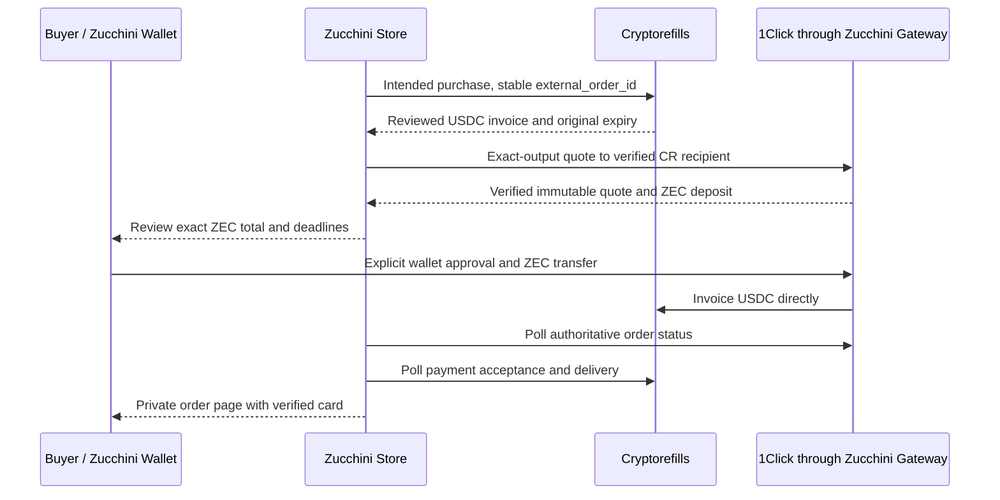

# Direct customer-funded Cryptorefills payment

Status: implemented against synthetic server contracts; upstream compatibility and
funded acceptance remain outstanding. Checkout and fulfillment stay disabled.
The storefront uses the Zucchini dapps SDK for connection, explicit address
permission, and payment. No Cryptorefills order or customer-funded swap has been
created by this work.

## Funds and responsibilities

The customer sends ZEC from their wallet to a per-order 1Click deposit. The swap
provider delivers native Solana USDC directly to Cryptorefills. Zucchini Store
coordinates the order and verifies progress; it receives neither asset and holds
no wallet spending key. Historical buffered orders keep their original funding
mode, recipients, encrypted storage and recovery rules.

## Implemented binding and recovery

`src/direct-settlement.mjs` persists every external creation attempt before I/O.
Invoice recovery reuses the original external order UUID. Swap recovery reads only
the original installation-owned gateway quote; a lost response cannot create a
replacement quote. Customer payment approval is a separate action after the exact
ZEC amount has been reviewed. The deposit URI appears only after payment intent
has been persisted. A saved order never automatically replays a wallet request.

The invoice and executable quote bind the original order, native Solana USDC mint,
exact output, customer ZEC cap, transparent Zcash refund address, gateway/provider
quote identities, absent deposit memo and both deadlines. Native USDC uses mint
`EPjFWdd5AufqSSqeM2qN1xzybapC8G4wEGGkZwyTDt1v`, six decimals and the original SPL
Token program. Gateway asset:
`nep141:sol-5ce3bf3a31af18be40ba30f721101b4341690186.omft.near`.

Finalized RPC account evidence must establish the initialized native-USDC canonical
ATA and its owner. The quote uses that verified owner; the payout must credit the
exact invoice account. This owner/ATA correspondence is a protocol assumption that
still needs authoritative 1Click/CR confirmation. Unsupported deposit memos, payer
binding, noncanonical accounts or changed identities block the route.

The customer supplies a maximum ZEC input before order preparation. The exact
quoted input is checked against it. Input slippage and unused-input refunds follow
1Click's [exact-output contract](https://docs.near-intents.org/api-reference/oneclick/request-a-swap-quote).
No fiat-rate padding or merchant balance is used to authorize payment.

`src/gateway-session.mjs` signs only the expected canonical authentication challenge
with a dedicated Ed25519 installation seed. It renews short-lived sessions under
the same installation identity, which owns quote recovery. This seed cannot spend
wallet funds. The immutable request UUID, not the transient session token, binds
an order. Quote POSTs are never silently retried after an uncertain result.

The gateway source includes exact-output execution, durable request reservation,
original-quote recovery and caller-bounded deadlines. Both exact-output gates stay
false in every environment. Its additive migration must precede the corresponding
Worker/container rollout. Ordinary exact-input swap contracts are preserved.

## Wallet approval

The store vendors the reproducible SDK candidate `0.3.0-direct-payment.1` from
source commit `f67c973`; provenance and checksums are in `vendor/`. It exposes typed
`getAddresses` and optional payment expiry. Connecting requests `send_transaction`
and `view_addresses`; reading a refund address happens only on the customer's
explicit button action. No balance, seed, viewing key or wallet installation
secret is requested.

The direct UI requires a future, integer approval cutoff and a memo-free transparent
payment URI. The scoped wallet patch bounds approval by the earlier of the caller
cutoff and ordinary wallet timeout, and checks again before signing. An older
wallet rejects the new expiry request; the store never retries without the cutoff.
The updated extension must be installed before real-funds acceptance.

Connection generation, network and order identity are rechecked after asynchronous
operations. Switching the visible order cannot prompt a stale payment or attach a
completed wallet transaction to the wrong order. The final amount must equal the
amount reviewed before the request. Repeated clicks create one wallet request.

## Authoritative settlement

A browser txid is a submission hint only. The coordinator polls the bound gateway
order and accepts `one_click_status` correlation only. A reported successful swap
must have the exact output and exactly one independently verified finalized Solana
payout matching native USDC, recipient owner, invoice ATA and amount. The credited
transaction/output/account reference cannot be assigned to another order.

Card delivery additionally requires authoritative Cryptorefills payment acceptance
and matching order IDs, beneficiary, brand, country, denomination and product.
Polling uses durable cooldown/backoff. Background ticks perform reads only and
never recreate an invoice, quote or wallet payment. Unknown states, missing finality,
contradictions and exhausted retries enter operator review without another send.

Before approval, cancellation persists intent before DELETE. An uncertain response
blocks all payment actions across restarts. Operator `recover_cancel` reads the
original provider order and closes the local order only after a matching final
cancellation/expiry. It does not repeat DELETE or restore a payable quote.

Swap failure and unused-input refunds return ZEC to the customer's bound transparent
address. Cryptorefills refunds after receipt of USDC are separate: the customer
uses the provider's emailed form to supply their own Solana USDC address, subject
to confirmation that v6 partner orders follow that procedure. Zucchini does not
send either refund or promise conversion back to ZEC.

## Provider contract and activation

The authenticated v6 Node example confirms `wallet_address`, `coin_amount`, and
`coin`. DELETE comments confirm the order IDs and `CANCELED` state. Public v5 code
shows `Done` and `deliveries[0].deliverable.pin_code`; these do not establish v6
completion fields or expiry. See [the contract review](cryptorefills-contract-review.md)
for the exact evidence and a narrow, unsent provider question draft.

Runtime mapping functions must establish Solana-specific price/identity eligibility,
original invoice expiry, recipient semantics, payment acceptance and delivery.
They are intentionally required source functions, not configurable field guesses.
Checkout cannot activate until those mappings and protocol compatibility are
reviewed. A backup partner API key is also required for documented 401 failover.

The CR catalog retains namespaced UUIDs and exact provider denominations. Selected
families can be published and refreshed using read-only endpoints; they stay
clearly marked as preview with unverified Solana pricing/identity eligibility.
Never use a default USDC-MATIC catalog price to authorize a Solana invoice.

Customer email and transport-derived IP go to CR only for an intended purchase,
with separate terms/privacy consent and no marketing opt-in. Provider branding,
conversion, caps, deadlines and the two refund routes are disclosed before approval.
Encrypted order capabilities and card data remain private. A capped real-funds
acceptance is a separate buyer action after the remaining gates are satisfied.
